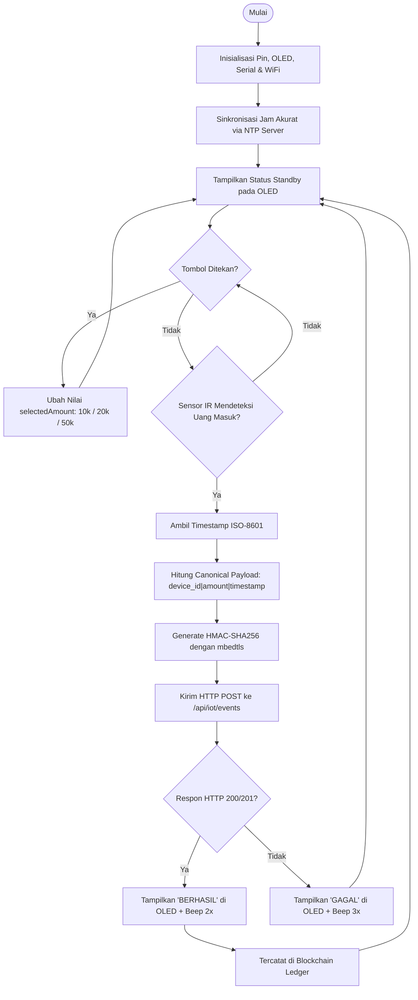

# 🔌 Dokumentasi Firmware ESP32 - Smart Donation Box (AsuhKita)

**Modul:** IoT Kotak Amal Pintar Panti Asuhan  
**PIC:** Primary Putri Ardiva (A3 - Integrasi & Pengujian)  
**Referensi SRS & PBI:** PBI-065, PBI-068, PBI-070 | FR-52, FR-53, FR-54

---

## 1. Deskripsi Perangkat

Kotak amal pintar ini dirancang untuk diletakkan di panti asuhan, masjid, atau stan donasi. Saat uang fisik (kertas atau koin) dimasukkan ke slot kotak amal:
1. **Sensor Inframerah (IR Proximity)** mendeteksi objek fisik yang melintasi slot.
2. Donatur/pengurus dapat memilih nominal donasi simulasi menggunakan **3 Tombol Nominal** (Rp 10.000, Rp 20.000, atau Rp 50.000).
3. **Layar OLED SSD1306** menampilkan status standby, nominal yang dipilih, progres transmisi, dan konfirmasi blok blockchain.
4. ESP32 menghitung **Tanda Tangan Kriptografi HMAC-SHA256** menggunakan *secret key* unik perangkat via akselerasi hardware `mbedtls`.
5. Data dikirim melalui WiFi ke endpoint backend AsuhKita (`POST /api/iot/events`).
6. Backend memverifikasi tanda tangan HMAC dan secara otomatis mencatat transaksi ke dalam buku besar **Blockchain Ledger (Blok tipe `IOT_EVENT`)**.

---

## 2. Tabel Skematik Pinout ESP32

| Komponen Hardware | Pin Komponen | Pin ESP32 | Keterangan / Fungsi |
|---|---|---|---|
| **Sensor IR Proximity** | OUT / Digital Pin | **GPIO 34** | Input deteksi uang (Active LOW) |
| | VCC & GND | 3.3V & GND | Daya modul sensor |
| **Push Button 1 (Rp 10k)** | Kaki 1 & 2 | **GPIO 18** & GND | Pilihan nominal Rp 10.000 (Internal Pullup) |
| **Push Button 2 (Rp 20k)** | Kaki 1 & 2 | **GPIO 19** & GND | Pilihan nominal Rp 20.000 (Internal Pullup) |
| **Push Button 3 (Rp 50k)** | Kaki 1 & 2 | **GPIO 23** & GND | Pilihan nominal Rp 50.000 (Internal Pullup) |
| **Layar OLED SSD1306** | SDA | **GPIO 21** | Komunikasi I2C Data |
| | SCL | **GPIO 22** | Komunikasi I2C Clock |
| | VCC & GND | 3.3V & GND | Daya Layar OLED 128x64 |
| **Active Buzzer** | Positif (+) | **GPIO 4** | Nada konfirmasi beep saat donasi berhasil |
| | Negatif (-) | GND | Ground |
| **Status LED** | Anoda (+) | **GPIO 2** | Built-in LED (indikator transmisi WiFi) |

---

## 3. Diagram Alir Logika Firmware (Flowchart)



---

## 4. Cara Instalasi & Flashing ke ESP32

### Kebutuhan Library Arduino IDE:
1. Buka **Arduino IDE** → Masuk menu **Library Manager** (`Ctrl + Shift + I`).
2. Pasang library berikut:
   - `Adafruit SSD1306` (oleh Adafruit)
   - `Adafruit GFX Library` (oleh Adafruit)
   - Library `WiFi`, `HTTPClient`, `mbedtls`, dan `time` sudah built-in dalam board package ESP32.

### Langkah Flashing:
1. Hubungkan board ESP32 ke laptop menggunakan kabel data micro-USB / Type-C.
2. Di Arduino IDE, pilih board: **Tools → Board → ESP32 Arduino → ESP32 Dev Module**.
3. Pilih port serial yang sesuai: **Tools → Port → COM...**.
4. Buka file `esp32_kotak_amal.ino`.
5. Sesuaikan variabel di baris 26-30:
   ```cpp
   const char* WIFI_SSID     = "Hotspot_HP_Anda";
   const char* WIFI_PASSWORD = "password_hotspot";
   const char* SERVER_ENDPOINT = "http://IP_KOMPUTER_ANDA:3000/api/iot/events";
   ```
6. Klik tombol **Upload** (tanda panah kanan).
7. Buka **Serial Monitor** pada baudrate `115200` untuk memantau status koneksi dan event transaksi secara real-time.

---

## 5. Mode Fallback (Simulasi Tanpa Hardware)
Sesuai klausul **PBI-067 & FR-54**, jika saat presentasi/evaluasi modul fisik ESP32 tidak dibawa atau terhalang jaringan, tim dapat menjalankan simulasi otomatis yang menghasilkan signature HMAC identik melalui terminal:
```bash
node backend/scripts/simulate_iot.js
```
Atau melalui tombol simulasi di halaman mobile:
**Menu Beranda → Ikon Kotak Amal Pintar → Tombol "Simulasikan Donasi Tunai"**.
